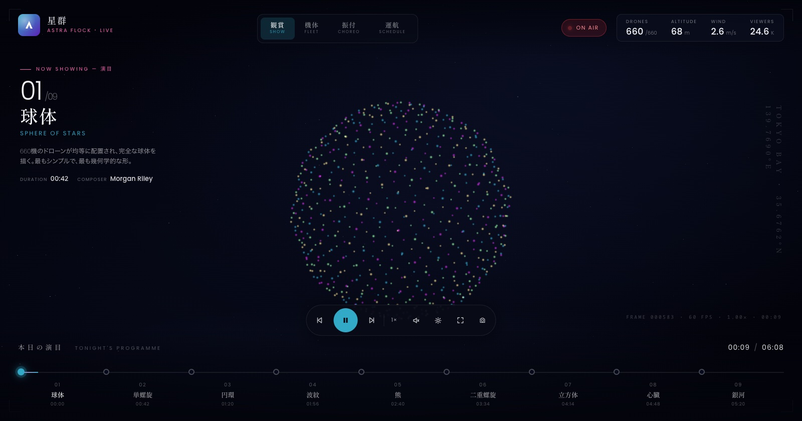

# Astra Flock — Drone Show / 星群

ドローンの多数機管理の実験です。660 機の編隊をブラウザで描画し、機体ごとの状態管理、振り付け、運航スケジュールまでを 1 つのアプリで試しています。作者のドローン関連プロジェクトで、多数の機体をまとめて扱う画面と仕組みを検証する場として作っています。

- **観賞** (`/`): 660 機 × 9 演目の編隊を Three.js の点群で描画。観客・機体目線・360° の視点
- **機体管理** (`/fleet`): 660 機の一覧（状態・電池・ファームウェア・本日の配置）と機体ごとの詳細。データは乱数の種を固定した模擬データ
- **振付** (`/choreography`): 演目の編集と、機体ごとの飛行経路 JSON の書き出し
- **運航スケジュール** (`/schedule`): 公演・予行・整備の月カレンダーと飛行前チェックリスト（模擬データ）

**デモ: https://drone-show-astra-flock.vercel.app/**

[](https://github.com/BoxPistols/drone-show-simulator/actions/workflows/test.yml)



## 見どころ

- **機体を指定して、その機体の目線で見る / 最大 4 機を同時に見る**: 3D 画面の点をクリック（タップ）するか ID を入力して乗る機体を選び、機体管理の詳細から「この機体の視点で見る」で直接開ける（`?pov=AS-042` で共有可）。他の機体の目線は小窓で最大 4 つ（スマートフォンは 2 つ）同時に表示し、WebGL の context は 1 つのまま render target と scissor で描く。重いときは本体より先に小窓の更新を間引き、数を減らす — 選択 [`picking.ts`](src/routes/show/picking.ts)、小窓の配置と間引き [`pip.ts`](src/routes/show/pip.ts)、ID の対応 [`src/lib/droneId.ts`](src/lib/droneId.ts)（いずれも単体テスト済み）、描画 [`useDroneShow.ts`](src/routes/show/hooks/useDroneShow.ts)
- **非力な端末でも止まらない適応品質**: フレーム時間を測って解像度を 1.5 倍から 0.75 倍まで自動で下げ、それでも遅ければ軽量モードへ切り替える — [`src/routes/show/hooks/resolution.ts`](src/routes/show/hooks/resolution.ts)（判定ロジックは単体テスト済み）、描画本体は [`useDroneShow.ts`](src/routes/show/hooks/useDroneShow.ts)
- **機体どうしの最小距離を保証する演目生成**: 9 演目の座標を純粋関数で作り、全演目で機体間 1.5m 以上をテストで確かめている — [`src/lib/formations.ts`](src/lib/formations.ts) / [`formations.test.ts`](src/lib/formations.test.ts)
- **CSP とテストで守る配信**: CSP `script-src 'self'` などのセキュリティヘッダ（[`vercel.json`](vercel.json)）、Vitest の単体テストと Playwright + axe の E2E / アクセシビリティ検査を CI で毎 PR 実行（[`.github/workflows/test.yml`](.github/workflows/test.yml)、[`e2e/`](e2e/)）

## クイックスタート

```bash
pnpm install   # Node 22+ / pnpm
pnpm dev       # http://localhost:8080
```

ビルド・テストのコマンドは [開発コマンド](#開発コマンド) を参照。

`drone-show-simulator.vercel.app` は旧 URL で、上記デモへ 307 redirect します。

---

## 機能ハイライト

### 観賞 (`/`)
- Three.js ポイントクラウドで **660 機 × 9 演目** を描画
- 演目: 球体 → 単螺旋 → 円環 → 波紋 → **熊** → 二重螺旋 → 立方体 → 心臓 → **銀河 (フィナーレ)**
- 下から見上げる斜めカメラデフォルト、マウスドラッグ / ホイールでオービット
- **視点**: 観客（ドラッグ回転 / ホイール・ピンチで距離）、**機体目線**（機体のカメラから編隊を見る。ドラッグで見回し、ホイール・ピンチで画角。「別の機体へ」で乗り換え）、**360°**（編隊のまわりを 20 秒で一周しつつ高さと距離がゆるく揺れる）
- **機体の指定**: 点をクリック / タップでその機体に乗る（ドラッグとは区別）。マウスを乗せると機体 ID の札が出る。設定パネルの「機体を指定」に `AS-123` や `123` を入力しても乗れる（↑↓ で ID を送る）
- **小窓（PiP）**: 他の機体の目線を最大 4 つ同時に表示（480px 以下は 2 つ）。Shift + クリックか「小窓に追加」で足し、小窓を押すとメインと入れ替わる。各小窓に機体 ID と座標を文字でも出す。軽量モードでは出さない
- **アンビエント音楽**: 音源ファイルを持たず Web Audio で生成（パッド + 風 + 鈴 + ステレオディレイ）。ON/OFF と音量、演目ごとに和音が移る。初めて ON にしたときだけコードを読み込む
- キーボード: `Space` 再生, `←→` 演目, `1-9` ジャンプ, `+-` 速度, `C` 視点切替, `V` 別の機体の目線, `[` `]` ID が前 / 次の機体, `M` 音楽, `F` 全画面, `S` スクリーンショット, `T` 設定, `?` ヘルプ, `Esc` 閉じる
- タッチ: ドラッグで回転、ピンチで距離。設定パネルはトランスポートの歯車ボタンから（キーボード無しでも開ける）
- **軽量モード** (設定パネル): 解像度上限 1 倍・残像なし・星半減。描画が間に合わない端末では自動で切り替わる
- `?f=<0..8>&speed=<n>` で URL deep-link、`?pov=AS-042&pip=AS-010,AS-200` で機体目線と小窓を共有（操作に合わせて URL も書き換わる）、localStorage で設定永続化

### 振付エディタ (`/choreography`)
- 演目の **追加 / 複製 / 削除 / ↑↓ 並び替え** + undo/redo (`Cmd/Ctrl+Z`, `Y`)
- パラメータ (高度 / 広がり / 遷移速度 / 補間曲線 / パレット上書き / 配分機数) を全てプレビューに視覚反映
- 3D 投影プレビュー (show と同じ `formations` を Y 軸回転 + 透視投影で再現)
- **音源 upload** + 波形描画 (Web Audio API `decodeAudioData` + peak detection)
- 再生/停止/シーク/ループ同期、block 左端ハンドルドラッグで開始時刻調整
- **BPM + ビートグリッド** + snap-to-beat (threshold 0.2 beat)
- **JSON round-trip**: 演目書出 / 読込 / 名前付きプリセット (localStorage)
- **機体書出**: 実機連携用 flightpath JSON (schema `astra-flock-flightpath/1`)

### 運用 (`/fleet`, `/schedule`)
- Fleet: 660 機 roster + 詳細 drawer + 4 アクション (test/recalibrate/log/maint), grid/table 切替。drawer の「この機体の視点で見る」で観賞ページをその機体の目線で開く（機体 ID と点群の番号の対応は `src/lib/droneId.ts` に一本化）
- Schedule: 月カレンダー + イベント drawer + pre-flight state サマリ + checklist

---

## デプロイ (Vercel)

`vercel.json` で Vite preset を明示。リポジトリを Vercel に接続すれば自動デプロイ。

| 設定 | 値 |
|---|---|
| Framework | `vite` |
| Build Command | `pnpm build` |
| Output Directory | `dist` |
| SPA fallback | `/(.*) → /index.html` |

セキュリティヘッダ一式 (HSTS / CSP / COOP / X-Frame-Options / Permissions-Policy) も `vercel.json` に集約。CSP は `script-src 'self'` のみで `unsafe-eval` 不要 (Vite ビルド済 JS のため)。

---

## アーキテクチャ

```
src/
├── main.tsx              ─ React + React Router エントリ
├── routes/
│   ├── show/             ─ Three.js scene を React でラップ
│   ├── choreography/     ─ store + components + audio sync
│   ├── fleet/            ─ roster + grid/table + drawer
│   ├── schedule/         ─ Calendar + EventDrawer
│   └── NotFoundPage.tsx  ─ 404 (React Router catch-all)
├── components/           ─ 共通 UI primitives + icons
├── hooks/                ─ useDirty, useKeyboard 等
├── lib/                  ─ formations / showSchema / shapes (純粋関数)
├── data/                 ─ fleet / schedule の typed data
├── styles/               ─ tokens.css + chrome.css + global.css + reset.css
├── types/
└── test/                 ─ vitest setup
```

ルーティングは React Router v6。各 route 配下に専用 components/ + hooks/ + types.ts。

---

## パフォーマンス方針

「それなりの環境でなくても見られる」ことを最優先にしている。手を入れるときは次を守る。

**読み込み**
- ページは route 単位で分割（`main.tsx` の `lazy`）。Three.js（gzip 114KB、JS の過半）は観賞ページだけが読み、`/fleet` `/choreography` `/schedule` では一切ダウンロードしない（E2E で担保）
- `index.html` にインラインの最小 CSS と読み込み表示を置き、JS が届く前から画面を出す。React 側は同じ見た目の `HydrateFallback` で引き継ぐ
- Web フォントは `preload` で取得だけ始め、`main.tsx` が適用する（描画をブロックしない）。Shippori Mincho は 500 の 1 ウェイトのみ。CJK フォントは 1 ウェイトで数百 KB になるため、12px 以下のボタン・ラベルには使わず OS の日本語サンセリフを使う
- `/assets/*` はハッシュ付きなので `Cache-Control: immutable`（`vercel.json`）

**観賞ページ (WebGL)** — `useDroneShow.ts`
- `antialias` と `preserveDrawingBuffer` は切る（点スプライトには効かず、モバイル GPU で高くつく）。スクリーンショットは描いた直後の同じタスクで読み出す
- 解像度は devicePixelRatio 1.5 倍を上限に、フレーム時間を測って 0.75 倍まで自動で下げる（`hooks/resolution.ts`、純粋ロジックでテスト済み）。「遅い」の基準は表示装置のリフレッシュ間隔の推定値から決め、30Hz の表示を過負荷と誤判定しない。下限でも遅ければ軽量モードへ切り替えてトーストで知らせる。この自動切替は今回の表示だけで、保存される設定には書かない
- タブが隠れたら止まる。一時停止中はカメラが止まった時点で描画もやめる。残像を切っているときは残像の描画自体をしない
- 半透明の UI に `backdrop-filter`（ぼかし）は使わない。動き続ける canvas の上では毎フレームぼかし直しになり、非力な GPU で最も重い処理になる
- HUD の更新は 5 回/秒、各オーバーレイは `memo` 化し、tick ごとにページ全体を描き直さない
- 機体目線では点の大きさに上限（頂点シェーダ）を設け、カメラの隣の機体が画面いっぱいの光にならないようにする
- 小窓（他の機体の目線）は WebGL の context を増やさず、同じ renderer で各小窓の render target に描いてから scissor / viewport で貼る。重いときは「小窓の更新を 2〜3 フレームに 1 回へ間引く → 小窓を 1 つずつ減らす → 本体の解像度を下げる → 軽量モード」の順に落とす（`pip.ts` の `createPipBudget`、単体テスト済み）。軽量モードでは小窓を出さない
- 音楽は音源ファイルを持たず Web Audio のノード十数個で生成する（音声スレッドで動き、JS は数秒に一度鈴を鳴らすだけ）。AudioContext は利用者の操作の中で作り、タブが隠れたら止める

**振付エディタ**
- 再生時計は ref（`clock.ts`）で持ち、React の state は 15 回/秒だけ更新する。プレビュー canvas は自前の `requestAnimationFrame` で時計を直接読む。シークは時計の `version` を上げるので、一時停止中でも読み手は描き直すべきと分かる
- 発光スプライトは `lib/glowSprite.ts` を観賞ページと共用し、見た目を揃える。色文字列は `#rgb` / `rgb()` / 色名を受け、読めなければ白で描く
- プレビューは発光スプライトを `drawImage` する（全面 `blur` はしない）。サイズは `ResizeObserver` で変わったときだけ取り直す
- ビートグリッド（最大 2000 本）、波形（200 本）、演目リスト、インスペクターは入力が変わらない限り描き直さない

## セキュリティ

- CSP `default-src 'self'` 基線 + `script-src 'self'` (CDN 経由スクリプト無し)
- Google Fonts (`fonts.googleapis.com` / `fonts.gstatic.com`) のみ style/font で許可
- HSTS / X-Frame-Options DENY / COOP same-origin / Referrer-Policy `strict-origin-when-cross-origin`
- localStorage 入出力は JSON.parse 失敗時にデフォルト fallback

---

## 開発コマンド

| Command | 内容 |
|---|---|
| `pnpm dev` | Vite dev サーバー (HMR, http://localhost:8080) |
| `pnpm build` | 本番ビルド → `dist/` |
| `pnpm preview` | build 成果物のローカル配信 (http://localhost:8080) |
| `pnpm typecheck` | `tsc -b --pretty` |
| `pnpm lint` | ESLint (`--max-warnings=0`) |
| `pnpm lint:fix` | ESLint + autofix |
| `pnpm format` / `format:check` | Prettier |
| `pnpm test` | Vitest (219 件, ~3s) |
| `pnpm test:watch` / `test:coverage` | watch / カバレッジ |
| `pnpm test:e2e` | Playwright E2E (29 件, chromium) |
| `pnpm test:e2e:install` | chromium ブラウザ初回取得 |
| `pnpm test:e2e:ui` | Playwright UI モード |
| `pnpm replay <file>` | flightpath JSON の CLI 再生デモ |

### pre-commit

`husky` + `lint-staged` で staged ファイルのみ:
- `*.{ts,tsx}` → `eslint --fix --no-warn-ignored` + `prettier`
- 他 → `prettier`

Vitest / E2E は CI 側で担保。

---

## 紹介動画

約 34 秒の紹介動画を [Remotion](https://www.remotion.dev/) で作っています（`video/`）。
アプリとは別パッケージで、ビルドや CI には含まれません。点群はアプリの `src/lib/formations.ts` の座標をそのまま使います。

```bash
cd video && pnpm install && pnpm render
# → video/out/astra-flock-intro.mp4
```

詳しくは [`video/README.md`](./video/README.md)。

## CI

`.github/workflows/test.yml` (push to main / 全 pull_request):
- `test` job: lint → typecheck → format:check → vitest → replay syntax → build
- `e2e` job (`needs: test`): chromium キャッシュ → build → playwright → report artifact

---

## 開発プロセス: Claude Design → Claude Code

- **デザイン**: Claude Design (claude.ai/design) で HTML/CSS/JS のプロトタイプとして作成し、ハンドオフ用の指示書付きで書き出した。指示書は [`docs/claude-design-handoff.md`](docs/claude-design-handoff.md) に保存している（プロトタイプ本体は React 化の完了後に #46 で削除）
- **実装**: Claude Code でプロトタイプを動かしたまま段階的に置き換えた。Vite + TypeScript の土台（#31）→ 共通 UI（#39）→ 観賞・振付・機体・運航の各ページ（#40–#43）→ Playwright + axe の E2E（#44）→ pre-commit と CI（#45）→ SPA としてのデプロイ切替（#46）。1 段階 1 PR で進めた
- **記録**: main の 59 コミット中 57 件に Claude の Co-Authored-By が付いている（`git log` で確認可能）。人は方針の決定・レビュー・マージを担当

## ライセンス

All rights reserved. ポートフォリオとして閲覧用に公開しています。GitHub 上での閲覧はできますが、コードの使用・複製・改変・再配布・転用は、事前の書面による許可がない限り禁止です。詳細は [`LICENSE`](LICENSE)。連絡先: https://asagiri-design.carrd.co/

利用している外部ライブラリ（Three.js、React、React Router）とフォント（Poppins、Shippori Mincho / Google Fonts）には、それぞれのライセンスが適用されます。紹介動画（`video/`）で使う Remotion には独自のライセンスがあり、従業員 4 人以上の会社で使う場合は有償のライセンスが必要です（[Remotion のライセンス](https://www.remotion.dev/license)）。動画に同梱した Noto Sans JP は SIL Open Font License 1.1 です。
